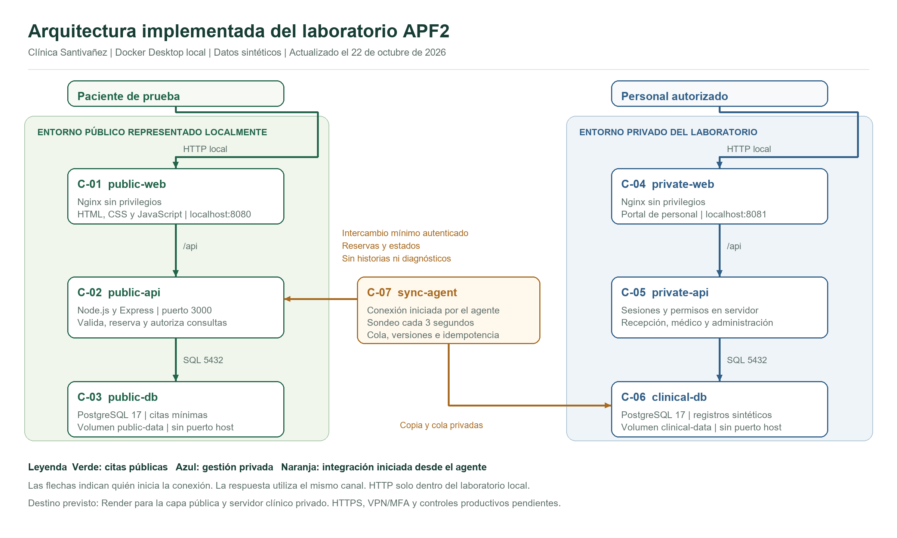
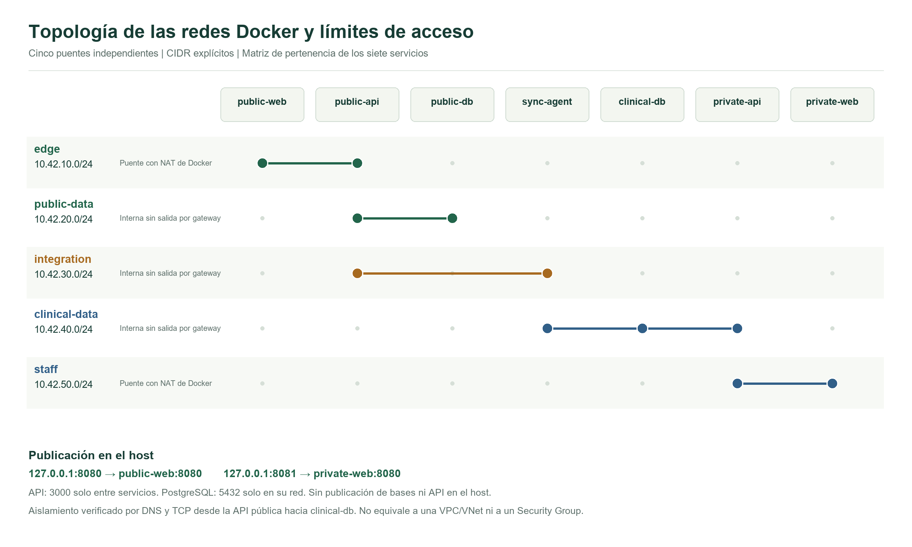

# Solución de Nube Híbrida para la Clínica Santivañez

Segundo avance del proyecto de Servicios Cloud, ciclo 2026-2. Este repositorio contiene un **laboratorio local implementado**, con datos sintéticos, que representa la separación entre una capa pública de citas y el entorno clínico privado. Render es el destino público previsto; no se ha contratado ni desplegado un servicio cloud en esta entrega.

La rúbrica permite laboratorios locales con diferencias documentadas frente a una VPC/VNet. Las redes Docker de este proyecto no se presentan como una VPC real ni como una nube privada completa.

## Inicio rápido

Requisitos: Docker Desktop con contenedores Linux, Docker Compose v2 o posterior, Node.js 22 o posterior y Git. Las pruebas requieren acceso a Docker desde la terminal. Reservar aproximadamente 2 GB de RAM para Docker y disponer de Internet en la primera construcción. No necesitas instalar PostgreSQL ni paquetes npm en Windows.

Desde la carpeta del proyecto:

```powershell
node scripts/setup.mjs
docker compose build
docker compose up -d --wait
```

- Portal de citas: [http://localhost:8080](http://localhost:8080).
- Portal del personal: [http://localhost:8081](http://localhost:8081).
- Salud: `/health` en ambos portales.
- Accesos del personal: archivo local `config/accesos-locales.txt`, generado automáticamente y excluido de Git.

El script conserva un `.env` existente. Los usuarios se crean solo al iniciar una base privada nueva; editar `.env` después no cambia sus contraseñas en PostgreSQL. Las contraseñas no se muestran en terminal ni en esta documentación.

## Qué puedes demostrar

1. Solicitar una cita con nombre ficticio y correo `example.invalid`, entre mañana y los siguientes 30 días, de lunes a sábado.
2. Guardar el comprobante que contiene UUID y clave. El estado inicial es **Solicitada**.
3. Entrar como `recepcion` en el portal interno. El agente copia la solicitud en unos segundos; pulsa **Actualizar**.
4. Confirmar la cita. Consultarla en el portal público con el UUID y su clave y verificar **Confirmada**.
5. Cancelarla desde la consulta pública y comprobar que el horario se libera.
6. Entrar como `medico`: solo puede consultar el registro sintético asignado. Recepción y administración no tienen acceso a registros clínicos.
7. Entrar como `administrador`: revisar auditoría y métricas del proceso.

No hay envíos de correo, SMS ni WhatsApp. La casilla de recordatorios registra una preferencia de prueba. La reprogramación, el mantenimiento completo de pacientes, MFA y el acceso clínico remoto quedan para APF3 y la preparación productiva.

## Arquitectura y recursos



| Servicio | Responsabilidad | Puerto interno | Red | Límite RAM / CPU |
|---|---|---|---|---|
| public-web | Portal público y proxy Nginx | 8080 | edge | 64 MiB / 0.25 |
| public-api | Validar y autorizar reservas | 3000 | edge, public-data, integration | 256 MiB / 0.5 |
| public-db | Citas mínimas en PostgreSQL | 5432 | public-data | 256 MiB / 0.5 |
| private-web | Portal interno y proxy Nginx | 8080 | staff | 64 MiB / 0.25 |
| private-api | Sesiones, roles, agenda y auditoría | 3000 | staff, clinical-data | 256 MiB / 0.5 |
| clinical-db | Gestión y registros sintéticos privados | 5432 | clinical-data | 256 MiB / 0.5 |
| sync-agent | Intercambio de reservas y estados | Sin entrada publicada | integration, clinical-data | 256 MiB / 0.5 |

Versiones observadas en la validación del 22/10/2026: Node.js 22.23.4, PostgreSQL 17.11, Nginx 1.30.6 y Docker Engine 29.9.2. Los tags de imágenes pueden recibir actualizaciones; el inventario de cada ejecución identifica las imágenes usadas. Los límites son parámetros del laboratorio, no resultados de dimensionamiento de una clínica real.

## Topología y accesos



| Red | CIDR | Conectividad |
|---|---|---|
| edge | 10.42.10.0/24 | Puente de acceso público representado, NAT de Docker |
| public-data | 10.42.20.0/24 | Interna, solo API pública y su base |
| integration | 10.42.30.0/24 | Interna, API pública y agente |
| clinical-data | 10.42.40.0/24 | Interna, API privada, agente y base clínica |
| staff | 10.42.50.0/24 | Puente para acceso del personal representado, NAT de Docker |

Solo se publican `127.0.0.1:8080` y `127.0.0.1:8081`. Los datos y las API no publican puertos en el host. Las tres redes internas no tienen salida por gateway. `edge` y `staff` usan el gateway del puente y la traducción de direcciones de Docker; **no son Internet Gateway ni NAT Gateway de AWS/Azure**. Los CIDR son exclusivos de este Compose y se asignan IP dinámicas. Si tu equipo ya usa alguno de estos rangos, cambia todos los CIDR antes de iniciar y actualiza el diagrama.

En un mismo puente Docker los miembros pueden alcanzar sus puertos internos; no hay reglas por puerto equivalentes a Security Groups. La segmentación limita qué servicios comparten red y la aplicación exige autenticación. E-01 prueba que la API pública no resuelve ni establece TCP con la base clínica. Esto no protege frente a un administrador del host Docker comprometido.

## Persistencia y respaldos

Los volúmenes `santivanez-apf2_public-data` y `santivanez-apf2_clinical-data` sobreviven a la recreación de contenedores y a `docker compose down`. Las pruebas recrean ambos contenedores de base y verifican una reserva y un registro privado.

```powershell
node scripts/verify-backup.mjs
```

Este script ejecuta `pg_dump -Fc`, copia los respaldos a `backups/`, restaura en bases temporales separadas, compara cantidades de registros y elimina solo esas bases temporales. E-03 registra el resultado y SHA-256 de los archivos. Los respaldos locales **no están cifrados** y están excluidos de Git. Un volumen persistente no sustituye a un respaldo. Antes de datos reales faltan cifrado, ubicación externa aprobada, retención, programación y medición de recuperación.

Para detener conservando los datos:

```powershell
docker compose down
```

No añadas `--volumes` si quieres conservar las bases.

## Validación reproducible

```powershell
node --test tests/integration.test.js
node scripts/validate-infra.mjs
node scripts/verify-backup.mjs
```

Las 24 comprobaciones del flujo integral incluyen concurrencia de reservas, datos inválidos, consulta con clave, controles de roles, sincronización, persistencia tras recreación y cancelación. El archivo de pruebas usa datos ficticios, elige un horario libre y deja la reserva de prueba cancelada. No es una prueba de carga ni una auditoría de seguridad completa.

Para comprobar los reintentos del protocolo desde el contenedor del agente, en PowerShell:

```powershell
Get-Content -Raw tests/sync-protocol.mjs | docker compose exec -T sync-agent node --input-type=module -
```

El resultado demuestra un comando repetido concurrentemente que modifica una sola versión y un comando obsoleto que no revierte una cancelación. No se imprimen claves.

Para la imagen destinada a Render, sin desplegarla:

```powershell
docker build -f docker/Dockerfile.render -t santivanez-apf2-render:2.0 .
node scripts/verify-render.mjs
```

Se verifica `PORT=10000` y la ausencia de portal, esquema SQL y agente privados en la imagen pública. El contenedor temporal se retira al terminar.

## Seguridad implementada y límites

- Reservas con SQL parametrizado, validación en servidor y restricción única por médico, fecha y hora cuando están activas.
- Clave de reserva aleatoria independiente del UUID; la base guarda su hash SHA-256. La clave es un secreto de acceso y solo se entrega en el comprobante.
- Contraseñas del personal con hash scrypt y sal, sesiones aleatorias con hash en PostgreSQL, vencimiento de una hora y cookies HttpOnly/SameSite Strict.
- Roles comprobados en cada ruta. Administración no obtiene acceso clínico por defecto; el médico consulta su asignación.
- Rechazo de orígenes ajenos en operaciones de escritura, límites de solicitudes y cabeceras de seguridad. Las interfaces insertan datos con `textContent`.
- Agente autenticado con token en servidor, cola persistente y control de versiones; el proxy público local bloquea las rutas de integración.
- API y agente como usuario `node`, Nginx sin privilegios, capacidades retiradas y límites de recursos. Usuario de aplicación SQL sin superusuario, creación de bases ni roles.
- `.env`, accesos, antecedentes y respaldos excluidos de Git y del contexto Docker.

HTTP y cookies sin `Secure` se usan únicamente en localhost con datos sintéticos. No se implementó TLS entre contenedores, MFA, cifrado de respaldos/discos, alta disponibilidad, auditoría inmutable ni políticas de conservación automáticas. El agente comparte el rol SQL privado de la API; antes de producción debe recibir un rol limitado a citas y cola, sin acceso a tablas clínicas. No se afirma cumplimiento normativo ni aptitud para pacientes reales.

## Destino Render y traslado a VPC/VNet

Ver [guía de despliegue](docs/despliegue-render.md). El Blueprint define un Web Service Docker y PostgreSQL en la misma región. El servidor Node sirve la interfaz pública directamente, por lo que en Render no se necesita un contenedor Nginx adicional. No se usa Static Site ni Supabase. El manifiesto contiene una selección técnica provisional de planes y región; no representa contratación ni presupuesto aprobado. No lo apliques sin revisar costos, región y configuración.

Render administra su red; este manifiesto no crea una VPC con tablas de rutas editables. [La propuesta de traslado](infra/migracion-vpc.md) describe subred pública, subredes de aplicación/datos privadas, gateway, NAT y reglas. Se mantiene Render como destino del proyecto; el ejemplo VPC sirve para explicar la equivalencia académica y requiere una decisión posterior de infraestructura.

## Evidencias y documentos

| ID | Archivo | Qué permite verificar |
|---|---|---|
| E-01 | docs/evidencias/E-01-redes.json | Cinco redes, tres internas y aislamiento DNS/TCP |
| E-02 | docs/evidencias/E-02-recursos.json | Siete contenedores, límites, puertos e imágenes |
| E-03 | docs/evidencias/E-03-restauracion.json | Restauración en dos bases temporales |
| E-04 | docs/evidencias/E-04-pruebas.json | 24 comprobaciones integrales |
| E-05 | docs/evidencias/E-05-version.json | Revisión del código y rama evaluada |
| E-06 | docs/evidencias/E-06-observabilidad.txt | CPU, memoria y logs en una captura puntual |
| E-07 a E-09 | docs/evidencias/*.png | Pantallas reales con datos ficticios |
| E-10 | docs/evidencias/E-10-dependencias.json | Resultado de npm audit al validar |
| E-11 | docs/evidencias/E-11-compatibilidad-render.json | Imagen pública en puerto 10000, probada localmente |
| E-12 | docs/evidencias/E-12-protocolo-sync.json | Idempotencia y conflicto de versiones |
| E-13 | docs/evidencias/E-13-manifiesto-render.json | Validación estructural con el esquema oficial de Render |

Esta rama contiene el código ejecutable, las instrucciones técnicas, los diagramas y las evidencias sintéticas. Los informes académicos, el guion y los scripts que incorporan datos del equipo se conservan únicamente en la entrega local.

## Estructura

```text
app/public/       Portal de citas en HTML, CSS y JavaScript
app/private/      Portal interno en HTML, CSS y JavaScript
app/server/       API, validación, autorización y acceso SQL
app/worker/       Agente de sincronización
docker/           Dockerfiles y proxy Nginx
infra/            Esquemas SQL, rol de aplicación y traslado propuesto
config/           Ejemplos sin secretos
scripts/          Configuración local, evidencias y generación de diagramas
tests/            Validación integral y protocolo de sincronización
docs/             Diagramas, evidencias y guía técnica de despliegue
referencias/      Antecedentes originales conservados solo localmente, fuera de Git
```

## Continuidad del código

Se conserva el caso del APF1 y la interfaz sin frameworks. El prototipo previo usaba LocalStorage, credenciales en JavaScript e intercambio manual de JSON. APF2 sustituye ese mecanismo por PostgreSQL, autorización en servidor e integración automática local. El historial de `main` conserva el prototipo. Sus antecedentes se mantienen por separado en la entrega local completa.

Los commits de preparación asistida están identificados con autoría Codex.

APF3 deberá abordar despliegue y acceso remoto aprobados, orquestación, escalabilidad, monitoreo continuo, cifrado, MFA, integración de recordatorios y pruebas de recuperación/fallo. El proyecto sigue siendo un laboratorio académico.
